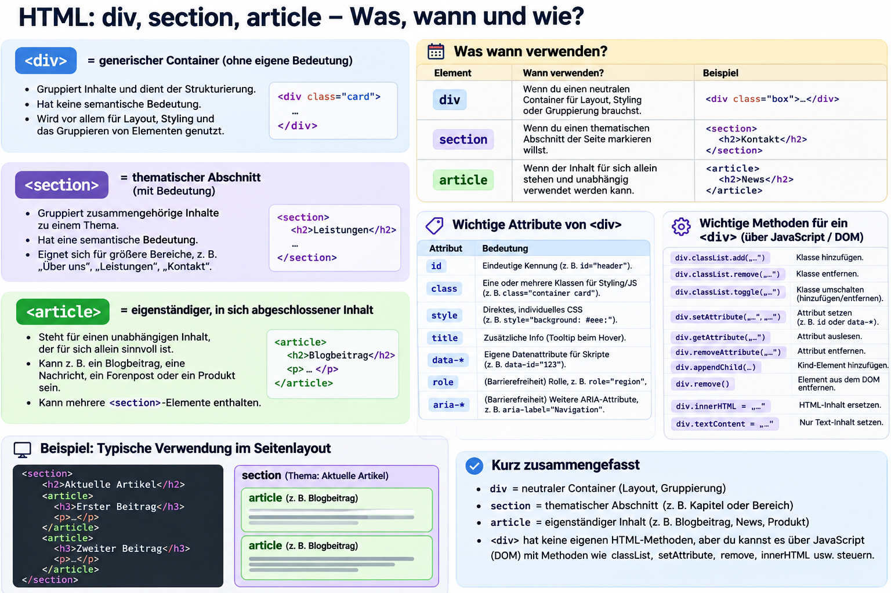

# `div`, `section` und `article`

## Was ist ein `<div>`?

`div` steht für „division“ (Abschnitt). Es ist ein neutraler Container: Es hat selbst keine inhaltliche Bedeutung und ohne CSS kein eigenes sichtbares Aussehen. Man kann es sich wie eine leere Box vorstellen, in die zusammengehörige HTML-Elemente gelegt werden.

Ein `<div>` ist standardmäßig ein **Block-Element**. Es beginnt in einer neuen Zeile und nimmt normalerweise die verfügbare Breite ein; mehrere `<div>`-Elemente stehen deshalb untereinander. Im Gegensatz dazu bleibt ein `<span>` im Textfluss.

## Wofür verwendet man ein `<div>`?

- **Ordnung:** Bild, Name und Beschreibung eines Profils können in einem gemeinsamen Container liegen.
- **Gemeinsames Styling:** Eine `class` oder `id` erlaubt, den gesamten Bereich mit CSS zu gestalten.
- **Layout:** Mit Flexbox oder Grid werden `<div>`-Container zu Spalten, Karten oder anderen Bereichen angeordnet.
- **JavaScript:** Über Selektoren kann der Bereich verändert, ein- oder ausgeblendet oder auf Klicks reagiert werden.

```html
<div class="profil">
  <h2>Alessia</h2>
  <p>Studentin Digital Healthcare</p>
</div>
```

```css
.profil {
  background-color: lightblue;
  padding: 15px;
}
```

Das `<div>` fasst die Inhalte zusammen; die Klasse `profil` gibt dem gesamten Bereich Hintergrundfarbe und Innenabstand.

## Eigenschaften, Attribute und Methoden eines `<div>`

Ein `<div>` kann über JavaScript gelesen und verändert werden. Häufige **Eigenschaften** sind:

```js
const div = document.querySelector("#myDiv");

div.id;            // ID des Elements
div.className;     // CSS-Klassen als Text
div.classList;     // CSS-Klassen verwalten
div.textContent;   // Textinhalt
div.innerHTML;     // Inhalt als HTML
div.children;      // direkte Kindelemente
div.dataset;       // data-Attribute
```

**Attribute** stehen im HTML, zum Beispiel `id`, `class`, `title` oder `data-*`. Man kann sie mit `getAttribute()` auslesen und mit `setAttribute()` setzen.

```js
div.setAttribute("title", "Weitere Informationen");
div.getAttribute("title");
```

Häufige **Methoden**:

```js
div.classList.add("active");       // CSS-Klasse hinzufügen
div.classList.remove("active");    // CSS-Klasse entfernen
div.classList.toggle("active");    // Klasse ein- oder ausschalten
div.append("Neuer Text");          // Inhalt am Ende hinzufügen
div.remove();                       // Element aus dem DOM entfernen
div.addEventListener("click", () => {
  console.log("Div wurde angeklickt");
});                                 // Auf ein Ereignis reagieren
```

## Inhalt eines `<div>` setzen

Der Inhalt kann zuerst in einer Variable gespeichert und anschließend in das `<div>` geschrieben werden:

```js
const message = "Hallo Anna";
div.textContent = message;
```

`textContent` schreibt **reinen Text**. HTML-Tags werden dabei nicht ausgeführt, sondern sichtbar dargestellt:

```js
div.textContent = "<strong>Wichtig</strong>";
// Im Browser sichtbar: <strong>Wichtig</strong>
```

`innerHTML` interpretiert den Inhalt dagegen als **HTML**:

```js
const content = "<strong>Wichtig</strong>";
div.innerHTML = content;
// Im Browser sichtbar: Wichtig (fett formatiert)
```

Für Texte – besonders Texte von Benutzerinnen und Benutzern – ist `textContent` die sichere Standardwahl. `innerHTML` verwendet man nur für vertrauenswürdigen HTML-Inhalt.

## Wann verwende ich welches Element?

- `<div>` ist ein neutraler Container ohne eigene Bedeutung. Er eignet sich für Layout, Styling oder das Gruppieren von Elementen, wenn kein passendes semantisches HTML-Element existiert.
- `<section>` beschreibt einen thematisch zusammengehörigen Bereich, meist mit einer Überschrift. Beispiele sind „Kontakt“, „Neuigkeiten“ oder „Unsere Leistungen“.
- `<article>` enthält einen eigenständigen Inhalt, der auch außerhalb der Seite sinnvoll wäre. Beispiele sind ein Blogbeitrag, eine Nachricht, eine Produktkarte oder ein Kommentar.

```html
<section>
  <h2>Neuigkeiten</h2>

  <article>
    <h3>Neue Öffnungszeiten</h3>
    <p>Ab Montag gelten neue Zeiten.</p>
  </article>
</section>
```

**Merksatz:** `section` gruppiert ein Thema, `article` ist ein eigenständiger Inhalt und `div` ist ein neutraler Container.

## Daten am Element speichern: `data-*`

`data-*`-Attribute speichern kleine Zusatzinformationen direkt im HTML. Das ist üblich für IDs oder Zustände der Benutzeroberfläche.

```html
<div id="userCard" data-user-id="42" data-status="active">
  Anna
</div>
```

In JavaScript werden sie über `dataset` gelesen:

```js
const card = document.querySelector("#userCard");

card.dataset.userId; // "42"
card.dataset.status; // "active"
```

Für große oder zentrale Anwendungsdaten verwendet man besser JavaScript-Objekte, eine API oder eine Datenbank.

## Präsentationsfolie


